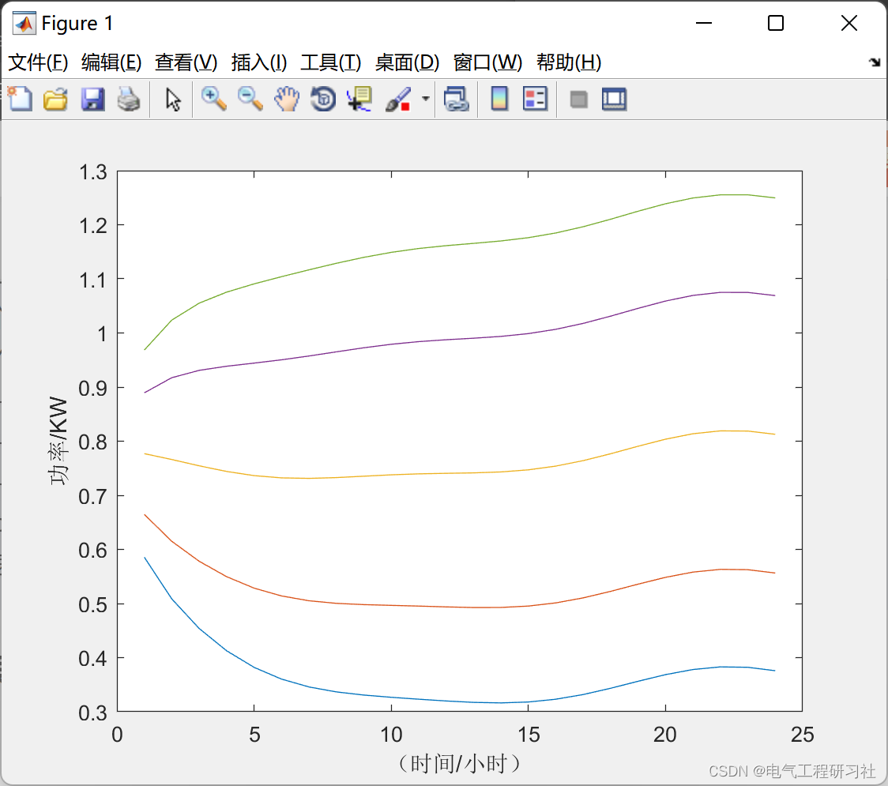
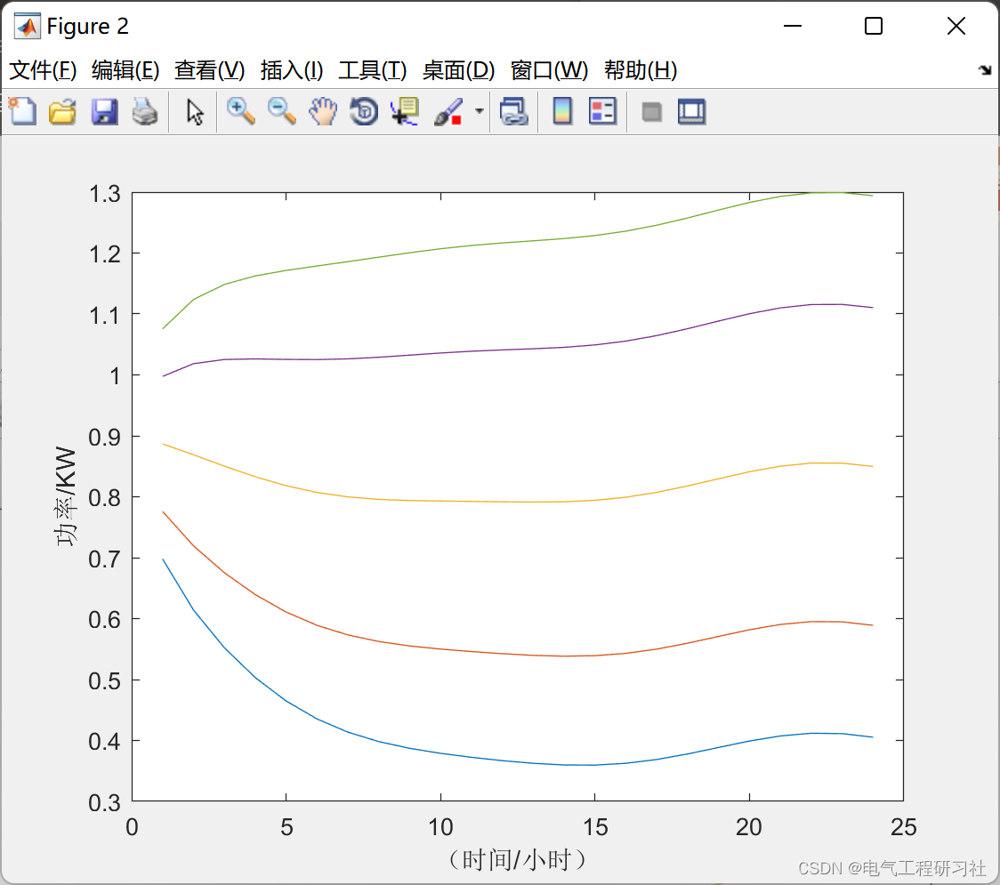
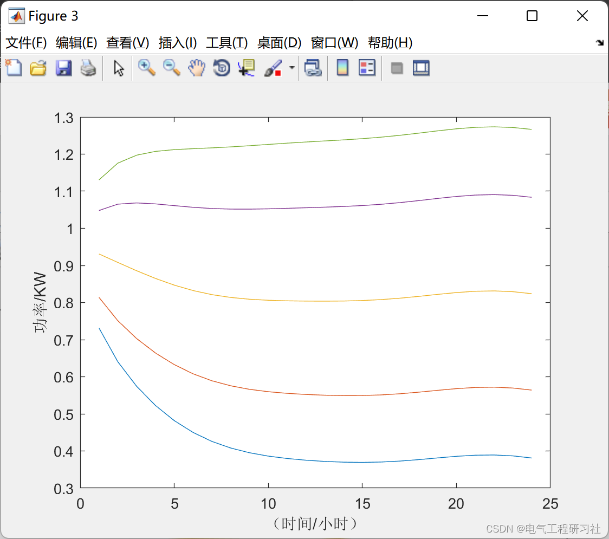
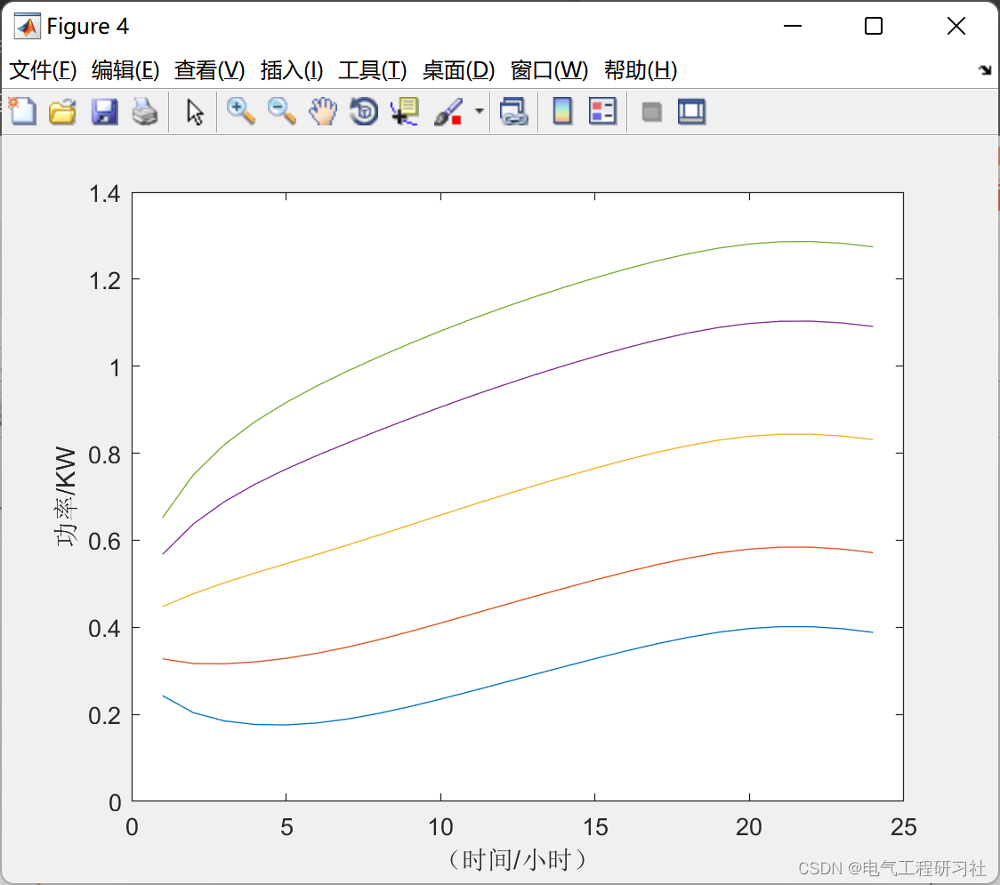

# MATLB|Wind Power Model Prediction Based on Matpower Optimization Scheduling

​  
📋📋📋This article is organized as follows: ⛳️⛳️⛳️Table of Contents: 1. Overview 2. Explanation 3. Parameter Representation 4. Running Results Display 5 MATLAB Code Implementation 6. Final Thoughts
Massive new energy grid integration. New energy power The proportion of electricity consumption continues to increase. The contradiction between consumption and utilization is prominent: competing for channels with conventional units. The pressure at full power operation of the critical section is relatively high. The wind power anti-peak shaving characteristic is prominent. Aggravate the difficulties of peak-shaving in the power grid. The consumption and utilization are mutually restrictive. On the basis of ensuring consumption levels. There is a downward trend in utilization rate. If there is a 500kV ultra-high voltage transmission line near a large wind farm, The wind utilization rate of this wind farm can be basically achieved to be close to 100%. Can be transmitted to a distant location through ultra-high voltage lines. If there is no ultra-high voltage line, Only beneficiaries can be absorbed locally. Additionally, new energy can only generate active power. Due to the angle of power factor, Sometimes trends do not flow in the direction we want them to. If some of it flows to other areas. Some areas require the installation of large reactive power devices. Form a "section". Do not let new energy flow through.
The wind power forecasting configuration file is generated based on the econometric model, which consists of an OLS component that captures seasonal effects and a dynamic time series component that captures residuals. The uncertainty required for prediction is realized through the var-cov matrix of white noise residuals in the time series model, enabling it to reflect the correlation between different wind fields. This paper also provides wind power implementation configuration files, which are generated from actual implementation data or econometric models.
2. Explain how to create a WY wind model object using the models from sites 2, 6, and 15 of the NPCC model:
widx = [2;6;15];\nwm = wy_wind_model('wind_model_npcc', widx);\n  
Generate 24 MOST conversion probabilities for each cycle, with 4 wind scenarios per cycle.
tp = wm.transition_probs(24, 4);\n  
Load the raw NPCC historical wind speed data (raw wind speed in m/s) and convert it to log(raw_wind_speed+1), as this is the basis of this model.
s = load('wind_data_npcc');\nlog_wind_data = log10(s.wind_data + 1);\n  
Extract 48-hour wind speed realization values for 3 interested locations from the original NPCC historical data, starting from noon on June 1, 2005 (data started at 1 AM on January 1, 2004).
pidx1 = wy_wind_date2pidx(24, [2004 1 1 1 0 0], [2005 6 1 12 0 0]);\nwsr = wm.realizations(pidx1, 48, log_wind_data);\n  
Generate 24-hour wind speed for 3 interested locations from the same hour onwards.
wsr = wm.realizations(pidx1, 24);\n  
Convert wind speed realization to wind power realization using the default (multi-turbine) power curve, expressed as a fraction of installed capacity.
wpr = wm.speed2power(wsr);\n  
Generate 24-hour wind speed forecasts for 3 locations of interest from the model, using 4 bars to represent the forecast distribution starting from the same hour.
ws0 = log_wind_data(pidx1-1, widx);\nwsf = wm.forecasts(pidx1, ws0, 24, 4);\n  
Convert wind speed forecasting into wind power generation realization using the 4th power curve (offshore) defined in section 4. The result is expressed as a fraction of installed capacity, 'wind_power_curve_EIC.txt'
s2p = wy_wind_power_curve(4, 'wind_power_curve_EIC.txt');\nwm = wy_wind_model('wind_model_npcc', [2;6;15], s2p);\nwpf = wm.speed2power(wsf);\n  
3. Parameter representation
np_all — The number of cycles in raw wind data nw_all — The number of wind stations in raw data (wind_data_npcc.mat is 16) np - The number of periods (for example, For the planned scope) nw - number of wind sites npd - number of cycles per day (usually 24). For hourly data) nb - Number of bins used for MOST wind model input widx - (,) Interested wind field index vector nw x 1 pidx - Scalar period index of raw historical wind data pidx1 - Scalar period index of the first cycleCompared to the original historical wind data, the first cycle dt - 1 x 6 standard Matlab date vector [yr, mo, day, hr, min, sec] specifies a specific period in the original historical wind data. yr = 4-digit year, mo = month (1-12), day = date (1-31), hr = hour (0-23), min = minute (0-59), sec = second (0-59) wind_data - (np_all x nw_all) wind speed matrix (in m/s unit), corresponding to period, location,Specific and start date/time (np_allnw_allnpddt0) log_wind_data — () matrix equals np_all x nw_alllog10(wind_data + 1) bins — bin specification, provided as: number of bins ((), ornb (1 x nb-1) bin boundary vector (standard deviation coefficient), where initial and final conditions are assumed.But exclude - Inf+Inf model - with structured fields: type - the type of wind speed model, 0 = based on raw_wind_speed in m/s, 1 = based on log (raw_wind_speed + 1), npd - the number of cycles per day (24 for hourly models), dt0 - a Matlab date vector corresponding to the first period of data when the model was created.The forecasts and implementations created from the model are w.r.t. this date, PID1 AR1 coefficient vector nw_all x 1 ols - () single station's OLS estimated parameter matrix: [C C Y1 S Y1 C Y2 S Y2 CD1 SD1 CD2 SD2] nw_all x 9 var_wnr - () variance matrix of each station nw_all x nw_all ar1_total - total wind's scalar AR1 coefficient ols_total - total wind volume 1 x 9 OLS estimated parameter vector var_wnr_total - total wind's scalar variance ws——wind speedThe unit depends on the type of model. 4. Run results display
Editor
Editor
Editor
5 Matlab code implementation - this article only showcases the main function program, the rest is seen in:
%% MATLB|Wind power model prediction based on matpower optimization scheduling\n\n%% Load data\ns = load('wind_data_npcc');\nwind_data = s.wind_data;\nlog_wind_data = log10(wind_data + 1);\n\nwidx = [1;3;5;7];   %% Wind Farm\nnp = 24;            %% 24 hours\nnb = 5;           \npidx0 = wy_wind_date2pidx(24, [2004 1 1 1 0 0], [2004 7 27 8 0 0]); %% 5000\nnw = length(widx);  %% Wind Scene Count\nnrh = 24;           %% x-axis length\n\n%% Creating a wind model\nwm = wy_wind_model('wind_model_npcc', widx);\n\n%% Initialization of output\ntp = cell(nrh, 1);\nwsr = cell(nrh, 1);\nwpr = cell(nrh, 1);\nwsf = cell(nrh, 1);\nwpf = cell(nrh, 1);\n\n%% Visual explanation (wind model parameter input)\nfor t = 1:nrh\n    %% Creating transition probability matrix\n    tp{t} = wm.transition_probs(np, nb);\n\n    %% Starting index of x-axis time\n    pidx1 = pidx0 - 1 + t;\n\n    %% Generate realized wind power generation\n    wsr{t} = wm.realizations(pidx1, np);\n    wpr{t} = wm.speed2power(wsr{t});\n\n    %% Generate prediction for wind power\n    ws0 = log_wind_data(pidx1-1, widx);\n    wsf{t} = wm.forecasts(pidx1, ws0, np, nb);\n    wpf{t} = wm.speed2power(wsf{t});\nend\n\n%% Wind Power Forecast Visualization\nfor i = 1:nw\n    figure(i)\n    plot(wsf{1}(:, :, i));\n    xlabel(' (Time/Hour)')\n    ylabel('Power/KW')\nend\n  
6. End Note: The references to theoretical works are from online sources, and if any infringement is found, please contact the blogger for removal.

## Images

<!-- PAYMENT_BLOCK -->

## Get this dataset

- Payment link (Stripe): [Buy now](https://buy.stripe.com/3cs8yP7sY87d0vu9AB)
- Payment QR code: 

<!-- /PAYMENT_BLOCK -->
